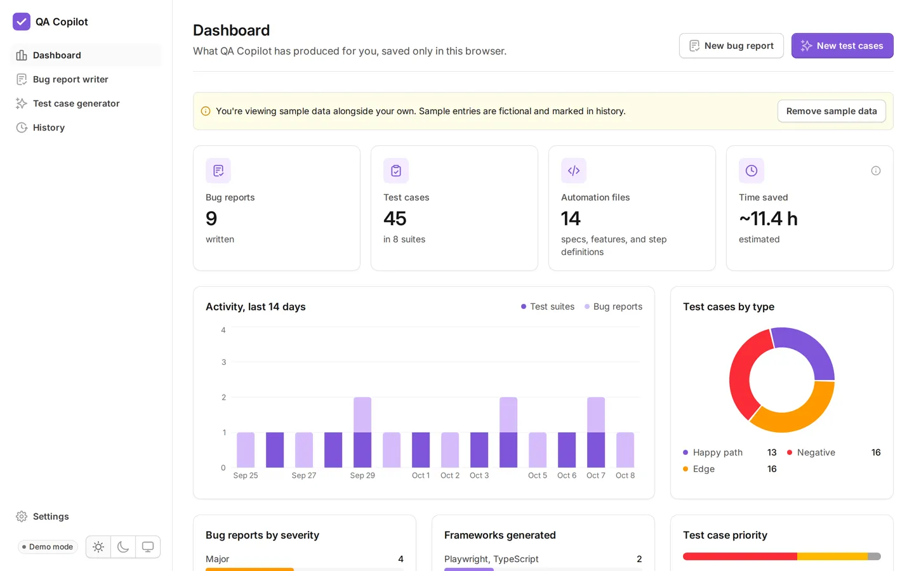
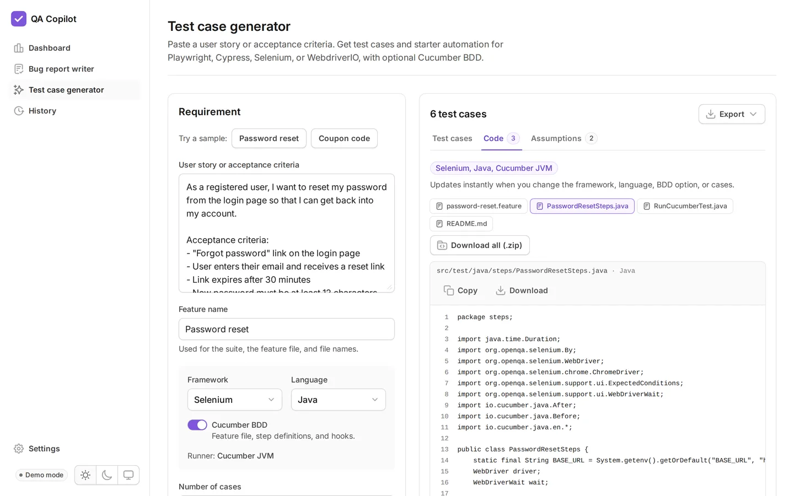
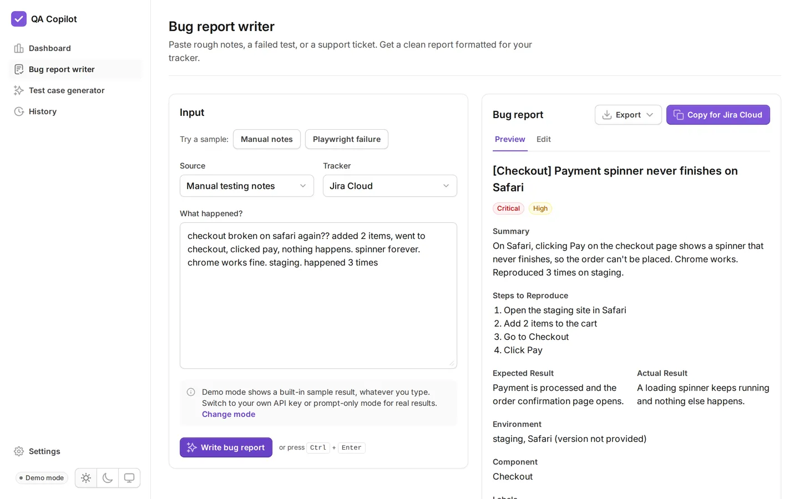

# QA Copilot

[](https://github.com/mohamedmoheyeldin/qa-copilot/actions/workflows/deploy.yml)
[](LICENSE)


AI helpers for QA work that adapt to your team instead of the other way around.

- **Bug report writer**: rough notes, failed Playwright, Cypress, or Selenium runs, and support tickets become clean bug reports for Jira, Azure DevOps, GitHub Issues, or any tracker.
- **Test case generator**: a user story becomes test cases plus starter automation for **Playwright, Cypress, Selenium, or WebdriverIO** in TypeScript, JavaScript, Python, Java, or C#, with optional **Cucumber BDD** (feature file, step definitions, and hooks).
- **Dashboard**: see what you've produced, the mix of test types, severities, frameworks, and estimated time saved.

**Live demo:** [mohamedmoheyeldin.github.io/qa-copilot](https://mohamedmoheyeldin.github.io/qa-copilot/) · **Case study:** [docs/case-study.md](docs/case-study.md)

> Free, open source, and runs entirely in your browser. No backend, no account, nothing stored on a server. Demo mode works with no API key.


<table>
<tr>
<td><picture><source media="(prefers-color-scheme: dark)" srcset="docs/media/dashboard-dark.webp"></picture></td>
<td><picture><source media="(prefers-color-scheme: dark)" srcset="docs/media/test-cases-dark.webp"></picture></td>
<td><picture><source media="(prefers-color-scheme: dark)" srcset="docs/media/bug-report-dark.webp"></picture></td>
</tr>
</table>

## Supported frameworks

| Framework   | Languages                                | Plain specs                                        | Cucumber BDD                                    |
| ----------- | ---------------------------------------- | -------------------------------------------------- | ----------------------------------------------- |
| Playwright  | TypeScript, JavaScript, Python, Java, C# | Playwright Test, pytest-playwright, JUnit 5, NUnit | Cucumber.js, pytest-bdd, Cucumber JVM, Reqnroll |
| Cypress     | TypeScript, JavaScript                   | Cypress                                            | cypress-cucumber-preprocessor                   |
| Selenium    | Java, Python, C#, TypeScript, JavaScript | JUnit 5, pytest, NUnit, Mocha                      | Cucumber JVM, behave, Reqnroll, Cucumber.js     |
| WebdriverIO | TypeScript, JavaScript                   | WebdriverIO (Mocha)                                | WebdriverIO Cucumber                            |

That's 28 combinations. With BDD on, the feature file and step definitions are generated from the same list of steps, so every step has a matching definition. A unit test checks this, and checks every combination for valid syntax.

**Change your mind after generating?** In demo mode the code updates instantly when you switch framework, language, or BDD, or edit a test case. With a real AI result you choose: **Update code with AI** (keeps your test cases, rewrites only the code) or **Convert instantly**, an offline conversion that needs no AI.

## What else it does

- **Exports**: PDF, Word, Excel, and Markdown for bug reports and test cases, plus a zip of every generated code file.
- **History**: your last 50 results, searchable, reopen with edits intact, backup and restore as JSON. Only redacted input is stored.
- **Any AI provider**: Anthropic (Claude), OpenAI, Google Gemini, or any OpenAI-compatible endpoint (OpenRouter, Ollama, LM Studio, a company gateway). **Load models** asks the provider which models your key can use.
- **Clear failures**: rejected keys, wrong model names, rate limits, outages, and replies cut off mid-JSON each get a specific message, with Try again only where it helps.
- **Presentation ready**: demo mode needs no key, each sample has its own realistic result, and one click loads two weeks of sample activity into the dashboard.

## Why it exists

Every team I've worked with uses a different tracker, different templates, and different rules about AI. QA Copilot is built around that reality:

- **Any tracker.** One structured report, many outputs: rich text (Jira Cloud, Azure DevOps, Confluence), Jira wiki markup (Data Center/Server), Markdown (GitHub, GitLab, Linear), plain text, and CSV for bulk import.
- **Your conventions.** Custom severity and priority scales, field labels, title patterns, custom fields, selector strategy, test ID attribute, Page Object Model, naming patterns, tags, and a style sample the AI matches.
- **Your AI rules.** Three AI modes, including one that works with whatever AI tool your organization approves.
- **Shareable setup.** Export settings to JSON and a teammate gets the same templates in one click. API keys are never exported.

## AI modes

| Mode               | What happens                                                                                                                               | Good for                                     |
| ------------------ | ------------------------------------------------------------------------------------------------------------------------------------------ | -------------------------------------------- |
| **Demo** (default) | Built-in sample results. No key, no network calls.                                                                                         | Trying the app                               |
| **Your API key**   | Calls Claude, OpenAI, Gemini, or any OpenAI-compatible endpoint directly from your browser. The key stays in your browser's local storage. | Personal use                                 |
| **Prompt only**    | Builds the full prompt for you to paste into any approved AI tool, then formats the answer you paste back.                                 | Workplaces that only allow approved AI tools |

Sensitive values (emails, SSNs, phone numbers, IP addresses, URLs, tokens, long ID numbers, plus your own custom terms) are masked before any prompt is built. Redaction reduces risk but can't catch everything, so follow your organization's AI policy.

## Tech stack

| Area       | Choice                                                                                                                             |
| ---------- | ---------------------------------------------------------------------------------------------------------------------------------- |
| UI         | [Untitled UI React](https://www.untitledui.com/react) (free, MIT) on React Aria                                                    |
| Framework  | React 19, TypeScript, Vite                                                                                                         |
| Styling    | Tailwind CSS v4                                                                                                                    |
| Validation | Zod (every AI response is validated before it's shown)                                                                             |
| Testing    | Playwright (30 tests, including mocked API runs and axe accessibility scans in light and dark mode), run in CI before every deploy |
| Hosting    | GitHub Pages via GitHub Actions                                                                                                    |

## Run it locally

Requires Node 22+.

```bash
npm install
npm run dev            # http://localhost:5173
```

Other scripts:

```bash
npm run build          # Typecheck and build to dist/
npm run preview        # Serve the production build
npm run test:unit      # Vitest: code generator, providers, exports, history, stats
npm run test:e2e       # Playwright tests against the production build
npm run test:e2e:ui    # Playwright UI mode
npm run test:e2e:edge  # Same tests in installed Microsoft Edge (no browser download)
npm run media          # Re-capture README media (start `npm run preview -- --port 4173` first; needs ffmpeg)
```

First time running tests: `npx playwright install chromium`. If that download is blocked on your network, run them with the Edge already installed on Windows instead: `npm run test:e2e:edge`.

## Quality

- **Unit tests** (Vitest, 63 tests) check all 28 framework, language, and BDD combinations for valid syntax (TypeScript is parsed, Python is compiled), that every Cucumber step has a definition, plus providers, exports, history upgrades, and dashboard stats.
- **End-to-end tests** (Playwright) cover every tool in all three AI modes. "Your API key" mode is tested by intercepting the provider call, so CI never needs a real key.
- **Accessibility**: every page is scanned with axe-core against WCAG 2.1 AA in both themes, plus a keyboard test for the skip link. Untitled UI is built on React Aria, so focus management and screen reader support come from a solid base.
- **Validated AI output**: every response passes a Zod schema before it reaches the screen, and parse errors name the fields that failed.

## Deploy to GitHub Pages

1. Push this repo to GitHub (public repo for free GitHub Pages).
2. In the repo, go to **Settings → Pages** and set **Source** to **GitHub Actions**.
3. Push to `main`. The workflow runs typecheck and Playwright tests, builds, and deploys.

The build uses relative paths and hash-based routing (`/#/settings`), so it works under any repo name or a custom domain with no extra config.

## Project structure

```
src/
├── components/qa/          App shell and QA Copilot components
├── components/base, application, foundations   Untitled UI components (owned source)
├── components/qa/tool/     Shared tool kit every tool page is built from
├── lib/codegen/            Offline code generator for every framework, language, and BDD runner
├── lib/export/             PDF, Word, Excel, Markdown, and zip exports
├── lib/frameworks.ts       The one table of frameworks, languages, and runners
├── hooks/use-generator.ts  Shared logic for the three AI modes, retries, and history hooks
├── lib/                    Types, settings, history, prompts, redaction, AI client, formatters
└── pages/                  Dashboard, bug report writer, test case generator, history, settings
tests/e2e/                  Playwright specs
docs/planning/              Product plans for this and future tools
docs/case-study.md          The problem this solves and the decisions behind it
scripts/capture-media.mjs   Regenerates README screenshots and the demo animation
```

## Working with Claude Code

`CLAUDE.md` describes the architecture and constraints for Claude Code. Project commands live in `.claude/commands/`:

- `/new-tool <description>`: add a new tool that works in all three AI modes
- `/add-component <name>`: add an Untitled UI component
- `/review`: review current changes against the project's constraints

## Roadmap

- Template editor for test case fields and CSV column mapping (Xray, Zephyr, TestRail)
- Screenshot input for bug reports
- Optional Cloudflare Worker proxy for direct "Create issue" in Jira
- Flaky test tracker and test results dashboard for Playwright reports

## Contributing

Contributions are welcome, especially new frameworks, languages, trackers, and AI providers. See [CONTRIBUTING.md](CONTRIBUTING.md). Please report security issues privately as described in [SECURITY.md](SECURITY.md).

## License

MIT. Untitled UI React open-source components are MIT licensed by Untitled UI.
